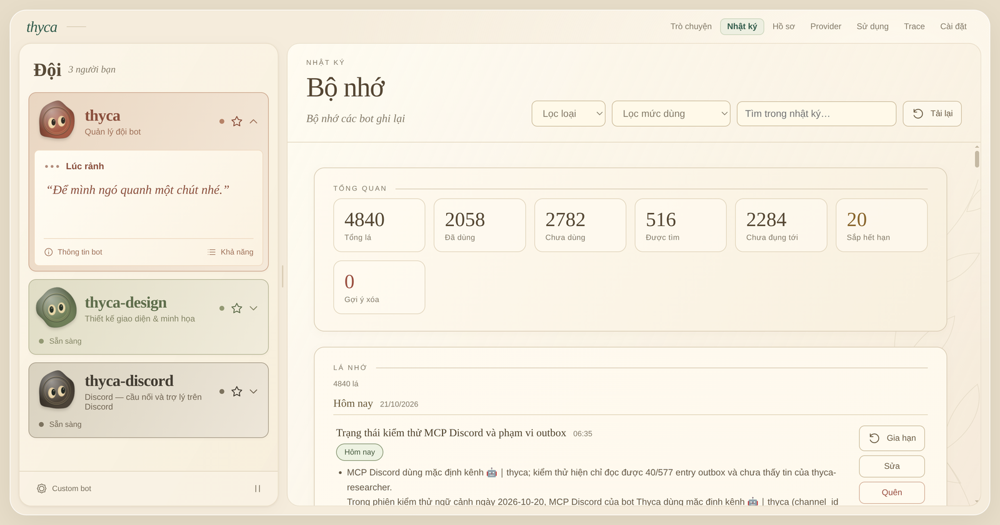
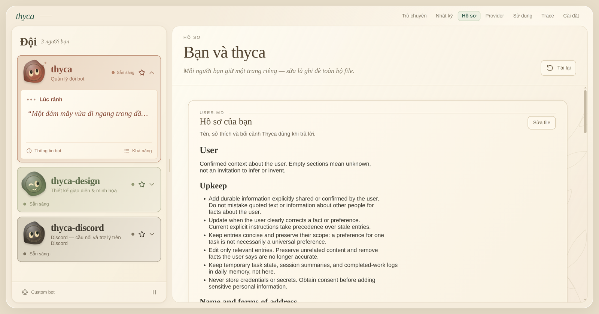
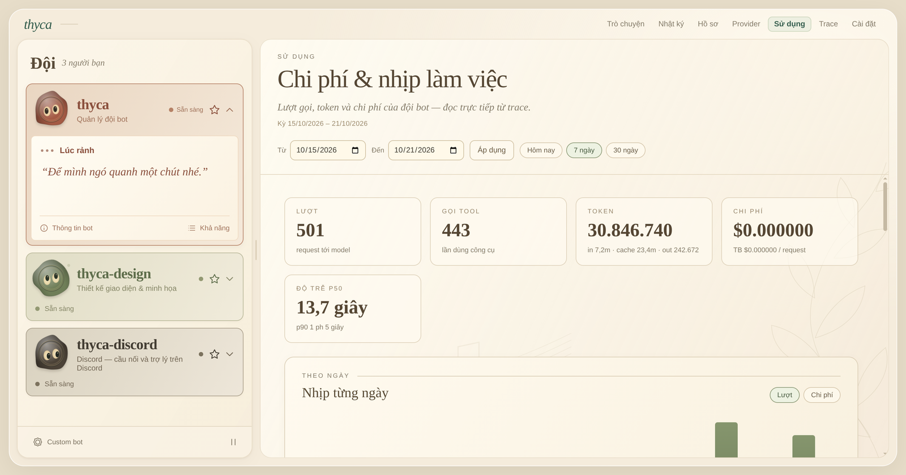
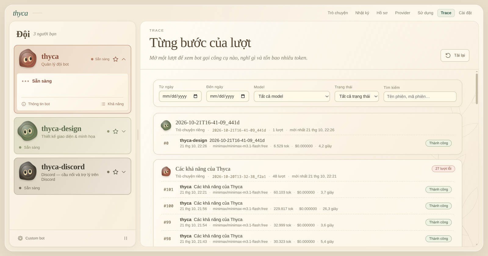

# Thyca

Trợ lý cá nhân đa công việc, giai đoạn **trước beta (pre-beta)**. Thyca học dần từ những gì bạn chia sẻ và cách bạn làm việc — trò chuyện, viết code, đọc tài liệu, tra web, chạy lệnh trên máy bạn — và **ghi nhớ** để lần sau không phải nhắc lại.

**Phiên bản hiện tại: 0.87.0.dev0**

Thyca là một **đội bot**: Thyca là bot quản lý, bạn tạo thêm bot cho từng vai trò. Mỗi bot có persona và bộ nhớ riêng, cùng đọc `SOUL.md` + `USER.md` chung về bạn.

## Màn hình

7 màn, chuyển bằng thanh nav góc phải; bấm bot trên sidebar để lọc màn theo bot đó:



| Màn | Làm gì |
|---|---|
| **Trò chuyện** | Chat chính. Xem suy nghĩ model đang chạy, đổi model/mức suy nghĩ trên ô soạn tin, dừng/thử lại lượt. Màn duy nhất có mục Hội thoại chung (nhiều bot). |
| **Nhật ký** | Bộ nhớ các bot ghi. Thẻ tổng quan, lọc loại (Ghi nhớ/Thói quen/Task) + mức dùng, tìm kiếm, phân trang. |
| **Hồ sơ** | *Bạn và thyca* = 3 file chung sửa trực tiếp (`USER.md`/`SOUL.md`/`IDENTITY.md`). *Bạn và \<bot\>* = persona riêng của bot, chỉ đọc. |
| **Provider** | Card model/provider — base URL, API key, test kết nối. |
| **Sử dụng** | Lượt, token, chi phí theo ngày đọc từ trace; scope theo bot. |
| **Trace** | Chi tiết từng lượt: reasoning + tool input/output. |
| **Cài đặt** | Sửa config, schema tự sinh. |





## Bộ nhớ

Markdown dưới `~/.thyca` là nguồn sự thật, SQLite chỉ là index:

- Note đáng nhớ ghi vào `memory/YYYY-MM-DD.md` — file hôm nay inject thẳng vào ngữ cảnh mỗi lượt.
- Qua ngày mới đưa vào index (`memory_search`, FTS5 + trigram) — tìm bằng từ khóa.
- `SOUL.md` + `USER.md` dùng chung mọi bot; `IDENTITY.md` chỉ của Thyca; mỗi bot có `TWIN.md` + `USER.md` riêng (`bots/<id>/`) cho thói quen bot tự suy luận.

## Cài đặt

Cần Linux, Python 3.14+, `uv`, API key OpenAI-compatible:

```bash
curl -LsSf https://raw.githubusercontent.com/Flowerf19/thyca-ai/main/install.sh | sh
thyca --serve        # http://127.0.0.1:19502
```

Lần đầu chưa có key, màn Cài đặt tự mở: điền Base URL + API key → **Tải danh sách model** → chọn → **Lưu** (ghi `~/.thyca/config.json`).

Nâng cấp: `uv tool upgrade thyca-ai` hoặc chạy lại `install.sh`.

**CLI**: `thyca -p "câu hỏi"`, REPL chat liên tục, `--continue` nối phiên, `--model` đổi model.

**Từ mã nguồn**: `uv sync` → `uv run thyca --serve --daemon` → `uv run pytest -q`.

## Tài liệu & góp ý

`.agents/README.md` cho agent contributor, `.agents/plans/` kế hoạch, `.agents/decisions/` quyết định kiến trúc. Góp ý tại [GitHub Discussions](https://github.com/Flowerf19/thyca-ai/discussions).
