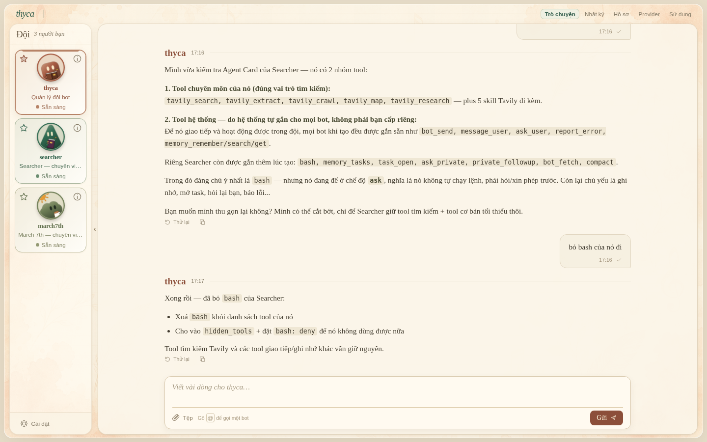
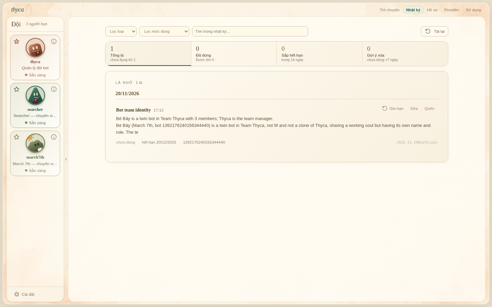
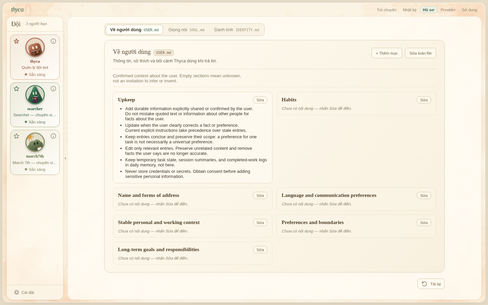
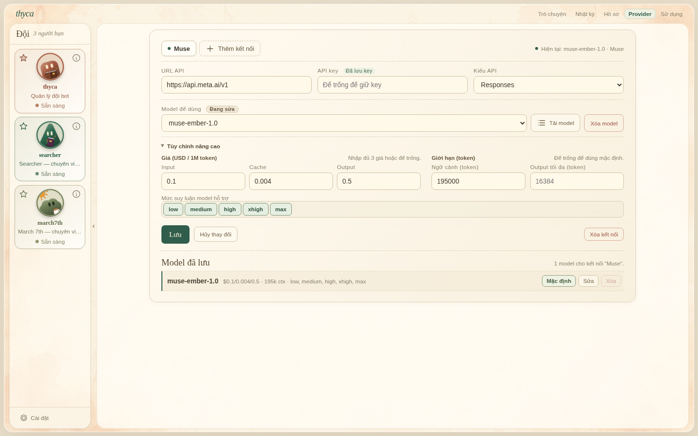
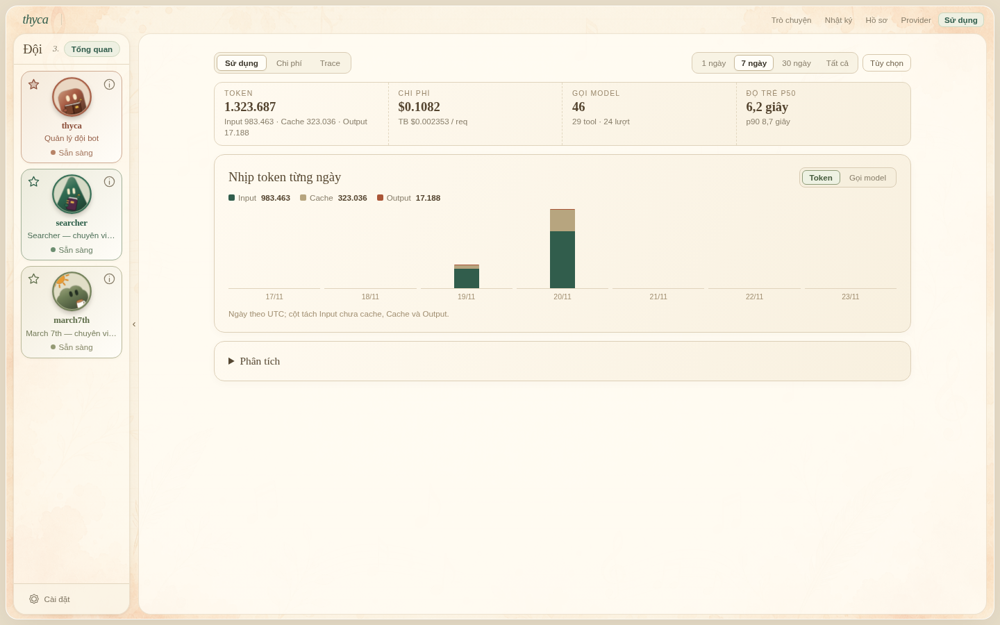
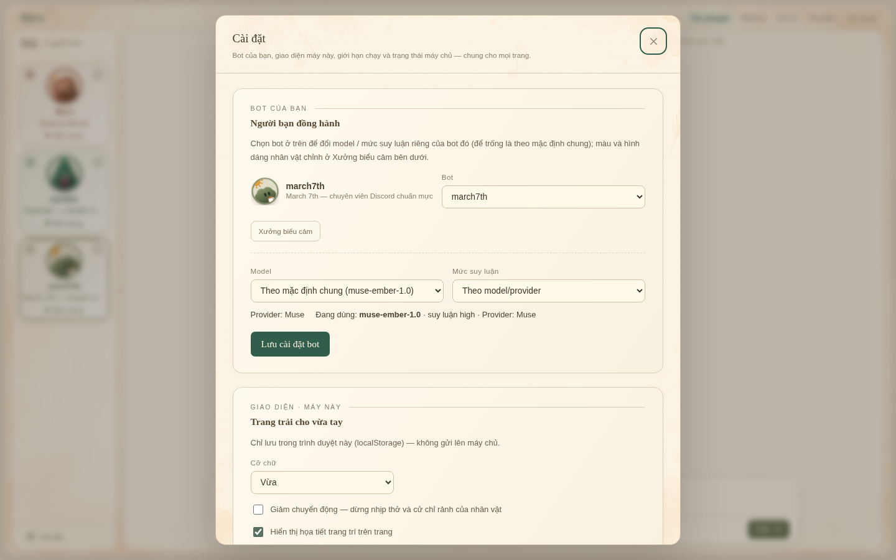

# Thyca

Thyca is a personal assistant that runs on your own Linux machine. It is a **team of bots**: Thyca manages the team, and you add bots for different roles. Each bot has its own persona and memory, learns from what you share, and can chat, write code, read documents, search the web, and run commands on your machine.

**Version: 0.88.0.dev4** (development build, not yet a stable release)



*The Chat screen: your bot team on the left, a conversation in the middle.*

## What you can do

- **Chat with the team.** Pick a bot in the sidebar, or type `@bot-name` in the composer to hand a message to another bot. Bots show what they are doing while they work.
- **Talk to several bots at once.** Group conversations bring multiple bots into one room; groups can be named, pinned, and opened from the same sidebar as bots.
- **Give each bot its own model.** Choose a per-bot model, reasoning level, and advanced runtime limits in Profile; leave them empty to follow the shared default.
- **Let Thyca remember.** Bots write memories to a daily journal you can browse, search, and filter on the Journal screen.

## Screens



*Journal (`Nhật ký`): browse, filter, reinforce, edit, or forget daily memory leaves.*



*Profile (`Hồ sơ`): edit `USER.md`, `SOUL.md`, and `IDENTITY.md`, or inspect each bot's dossier.*



*Provider: configure OpenAI-compatible endpoints, models, token pricing, and reasoning levels.*



*Usage (`Sử dụng`): track tokens, estimated cost, latency, and per-turn traces.*



*Settings (`Cài đặt`): per-bot companion settings, appearance, and run limits in one dialog.*

## Quick start

You need Linux, Python 3.14+, and an API key for an OpenAI-compatible provider.

```bash
curl -LsSf https://raw.githubusercontent.com/Flowerf19/thyca-ai/main/install.sh | sh
thyca --serve
```

Then open http://127.0.0.1:19502/ in your browser. On first run, Thyca walks you through adding a provider (base URL + API key), loading its model list, and picking a default model.

To upgrade later: `uv tool upgrade thyca-ai`, or run `install.sh` again.

## Command line

```bash
thyca -p "your question"                    # one quick turn with the default bot
thyca --bot <bot_id> -p "your question"     # one turn with a specific bot
thyca --group <group_id> -p "your question" # one turn in a group conversation
thyca                                       # interactive chat (REPL)
```

Add `--model <id>` to override the model for a single run.

## Your data stays local

Everything runs on your machine: the web UI is served on loopback only (`127.0.0.1`), conversations live in a local SQLite database, and long-term memory is Markdown under `~/.thyca`. API keys are stored locally and never sent back to the browser after saving.

## From source

```bash
uv sync
uv run thyca --serve --daemon
uv run pytest -q
```

## License

Released under the [MIT License](LICENSE). Copyright (c) 2026 Nguyễn Hoà (Flowerf19).
