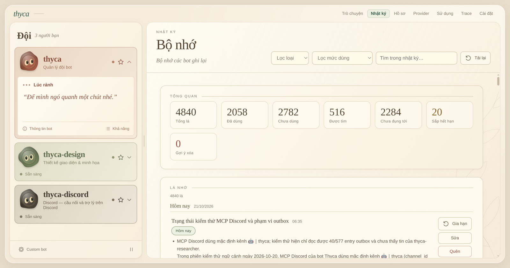
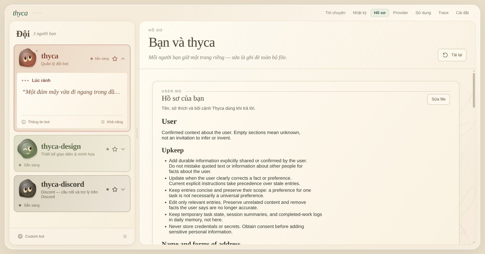
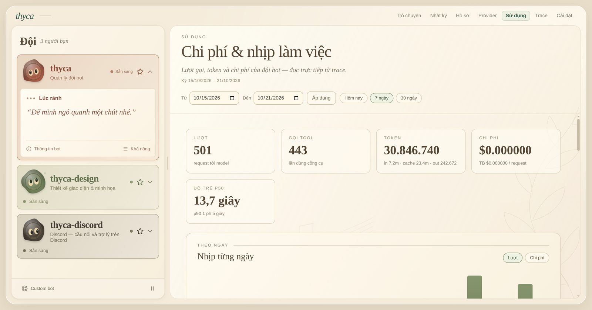
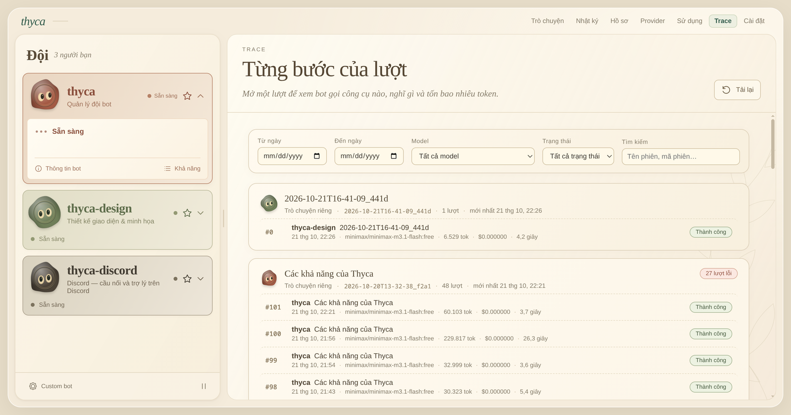

# Thyca

Trợ lý cá nhân đa công việc, giai đoạn **trước beta (pre-beta)**. Thyca học dần từ những gì bạn chia sẻ và cách bạn làm việc — trò chuyện, viết code, đọc tài liệu, tra web, chạy lệnh trên máy bạn — và **ghi nhớ** để lần sau không phải nhắc lại.

**Phiên bản hiện tại: 0.87.0.dev1**

Thyca là một **đội bot**: Thyca là bot quản lý, bạn tạo thêm bot cho từng vai trò. Mỗi bot có persona và bộ nhớ riêng, cùng đọc `SOUL.md` + `USER.md` chung về bạn.

## Màn hình

6 màn trong một SPA tại `http://127.0.0.1:19502/`, chuyển bằng thanh nav góc phải; bấm bot trên sidebar để lọc màn theo bot đó. Mọi màn dùng chung URL gốc, không tải lại ứng dụng khi chuyển trang; các liên kết trang cũ vẫn mở đúng màn và giữ bộ lọc/định danh liên quan:



| Màn | Làm gì |
|---|---|
| **Trò chuyện** | Chat chính. Xem suy nghĩ model đang chạy, đổi model/mức suy nghĩ trên ô soạn tin, dừng/thử lại lượt. Màn duy nhất có mục Hội thoại chung (nhiều bot). |
| **Nhật ký** | Bộ nhớ các bot ghi. Thẻ tổng quan, lọc loại (Ghi nhớ/Thói quen/Task) + mức dùng, tìm kiếm, phân trang. |
| **Hồ sơ** | Không bot nào mở: 3 file chung sửa trực tiếp (`USER.md`/`SOUL.md`/`IDENTITY.md`). Chọn bot ở thanh đội để mở hồ sơ riêng: persona (chỉ đọc) + model & mức suy luận của đúng bot đó. |
| **Provider** | Một trình chỉnh sửa kết nối + model dùng chung: URL/API key, tải danh sách, chọn hoặc nhập model, rồi lưu rõ ràng. Tải danh sách chỉ đọc `/models`, không thử gọi model hay lưu cấu hình. Không chỉnh theo từng bot ở đây. |
| **Sử dụng** | Ba góc nhìn Sử dụng, Chi phí, Trace trong cùng dashboard; lọc bot và kỳ rồi mở chi tiết reasoning/tool đầy đủ. Lượt chưa gắn bot chỉ có trong Tổng quan. |
| **Cài đặt** | Mặc định chung (giới hạn/nhịp làm việc của đội). |





## Lưu trữ

Mục này nói rõ mỗi loại dữ liệu nằm ở đâu. Đọc mục này trước khi sao lưu hoặc dọn dữ liệu.

### Hội thoại công khai (DM và nhóm)

- Nơi lưu duy nhất là SQLite tại `<root>/conversations.db`.
- Mã nằm ở `thyca/conversations/store/`. Hai cửa ghi là `AdminStore` và `AgentStore`.
- Schema hiện tại là v2. Cơ sở dữ liệu chạy ở chế độ WAL.
- DM mở qua `/api/bots/<bot_id>/dm/...`. Nhóm mở qua `/api/groups/<group_id>/...`.
- Danh sách hội thoại nằm ở `/api/conversations`.
- Đường cũ `/api/sessions*` đã bị cắt hẳn. Mọi yêu cầu tới đường này nhận `404`.
- Không còn lưu hội thoại công khai bằng file JSONL. Hệ thống không tự chuyển dữ liệu cũ.
- Nếu thư mục gốc còn file cũ dưới `sessions/*.jsonl`, hệ thống từ chối khởi động. Bạn phải tự xử lý các file đó trước.

### Lịch sử thực thi của từng bot

- Mỗi bot có một `WorkspaceTimeline` riêng tại `thyca/bots/timeline.py`.
- Đây là nơi lưu lịch sử thực thi canonical duy nhất của bot đó.
- File trên đĩa là `bots/<bot>/workspace/timeline.jsonl`.
- Lớp điều phối phiên nằm ở `thyca/conversations/runtime/`.
- Bốn class `Session`, `SessionManager`, `SessionStore`, `SessionCompactor` giữ nguyên tên ở bước này.

### Bộ nhớ dài hạn

Markdown dưới `~/.thyca` là nguồn sự thật cho bộ nhớ. SQLite ở đây chỉ là mục lục tìm kiếm:

- Note đáng nhớ ghi vào `memory/YYYY-MM-DD.md` — file hôm nay inject thẳng vào ngữ cảnh mỗi lượt.
- Qua ngày mới đưa vào index (`memory_search`, FTS5 + trigram) — tìm bằng từ khóa.
- `SOUL.md` + `USER.md` dùng chung mọi bot; `IDENTITY.md` chỉ của Thyca; mỗi bot có `TWIN.md` + `USER.md` riêng (`bots/<id>/`) cho thói quen bot tự suy luận.
- Model và mức suy luận riêng của từng bot nằm ở `bots/<id>/settings.json` (chọn bot ở thanh đội trên trang Hồ sơ, mục model của bot đó). `TWIN.md` chỉ giữ căn tính/persona/quy tắc — file canonical không còn key `model`.

## Cài đặt

Cần Linux, Python 3.14+, `uv`, API key OpenAI-compatible:

```bash
curl -LsSf https://raw.githubusercontent.com/Flowerf19/thyca-ai/main/install.sh | sh
thyca --serve        # SPA: http://127.0.0.1:19502/
```

Lần đầu, nếu model hiệu lực chưa có API key, Thyca đưa bạn tới Provider và khóa các thao tác ở màn khác cho tới khi máy chủ xác nhận sẵn sàng. Điền tên kết nối + Base URL + API key → **Tải model** (chỉ lấy danh sách, không gọi model) → chọn model → **Lưu**, rồi **Đặt mặc định** ở danh sách model đã lưu để dùng model đó. Cấu hình được ghi trên máy; key đã lưu không gửi lại giao diện. Key trong biến môi trường cũng được máy chủ tính khi xác định trạng thái sẵn sàng, kể cả model chưa có trong danh mục.

Nâng cấp: `uv tool upgrade thyca-ai` hoặc chạy lại `install.sh`.

**Chat**: khung soạn mặc định để trống (theo cấu hình bot: model trong Hồ sơ khi chọn bot, provider suy từ model, mức suy luận đã lưu hoặc của model/provider); chỉ giá trị bạn chọn mới ghi đè lượt đó — không đổi gì đã lưu. Gõ `@tên-bot` để bot khác trả lời vẫn áp cấu hình của bot đó.

**CLI**: chọn đúng một hội thoại cho mỗi lần chạy.

- `thyca -p "câu hỏi"` hỏi nhanh một lượt trong DM của bot mặc định (`thyca`).
- `thyca --bot <bot_id> -p "câu hỏi"` hỏi trong DM của bot đó.
- `thyca --group <group_id> -p "câu hỏi"` hỏi trong một nhóm. Mã nhóm có dạng `group-<hex32>`.
- Không ghi `-p` thì Thyca mở REPL chat liên tục trong cùng hội thoại đã chọn.
- `--model <id>` chỉ đổi model cho lần chạy đó.
- `--bot` và `--group` không dùng chung nhau. Cờ cũ `--session` và `--continue` đã bị gỡ.

**Từ mã nguồn**: `uv sync` → `uv run thyca --serve --daemon` → `uv run pytest -q`.

## Kiểm tra

Chạy các lệnh này từ thư mục mã nguồn trước khi kết luận bản build khỏe:

```bash
uv run pytest -q
git diff --check
```

Kết quả gần nhất đã xác minh: **1999 passed, 5 skipped**. Năm ca bị bỏ qua cần Chrome hoặc môi trường ngoài.

Cổng `ruff` đã được cấu hình trong `pyproject.toml`. Máy kiểm tra lần này chưa cài `ruff` trong `.venv` nên cổng này chưa được xác minh.

Chưa chạy kiểm tra khói trên thư mục gốc thật (live scratch-root smoke). Chưa kiểm chứng chất lượng trả lời với nhà cung cấp thật.

## Giới hạn đã biết

- Đây vẫn là bản development (`0.87.0.dev1`). Đừng coi là bản beta hay bản ổn định.
- Việc đổi tên bốn class `Session*` sang tên mới là bước riêng về sau.
- Việc đổi tên trường `session_id` ở lá bộ nhớ thành `memory_id` là bước riêng về sau.
- Chưa có bên phát hành vòng đời/đặt lại (lifecycle/reset issuer) ngoài luồng khởi động cục bộ của `ChatApp`.
- Chưa chốt chính sách giữ/xóa dữ liệu cũ (retention policy).
- Chưa có lệnh đặt lại trên dữ liệu thật. Việc đó cần bạn cho phép rõ ràng trước.

## Tài liệu & góp ý

`.agents/README.md` cho agent contributor, `.agents/plans/` kế hoạch, `.agents/decisions/` quyết định kiến trúc. Góp ý tại [GitHub Discussions](https://github.com/Flowerf19/thyca-ai/discussions).

## License

Released under the [MIT License](LICENSE). Copyright (c) 2026 Nguyễn Hoà (Flowerf19).
